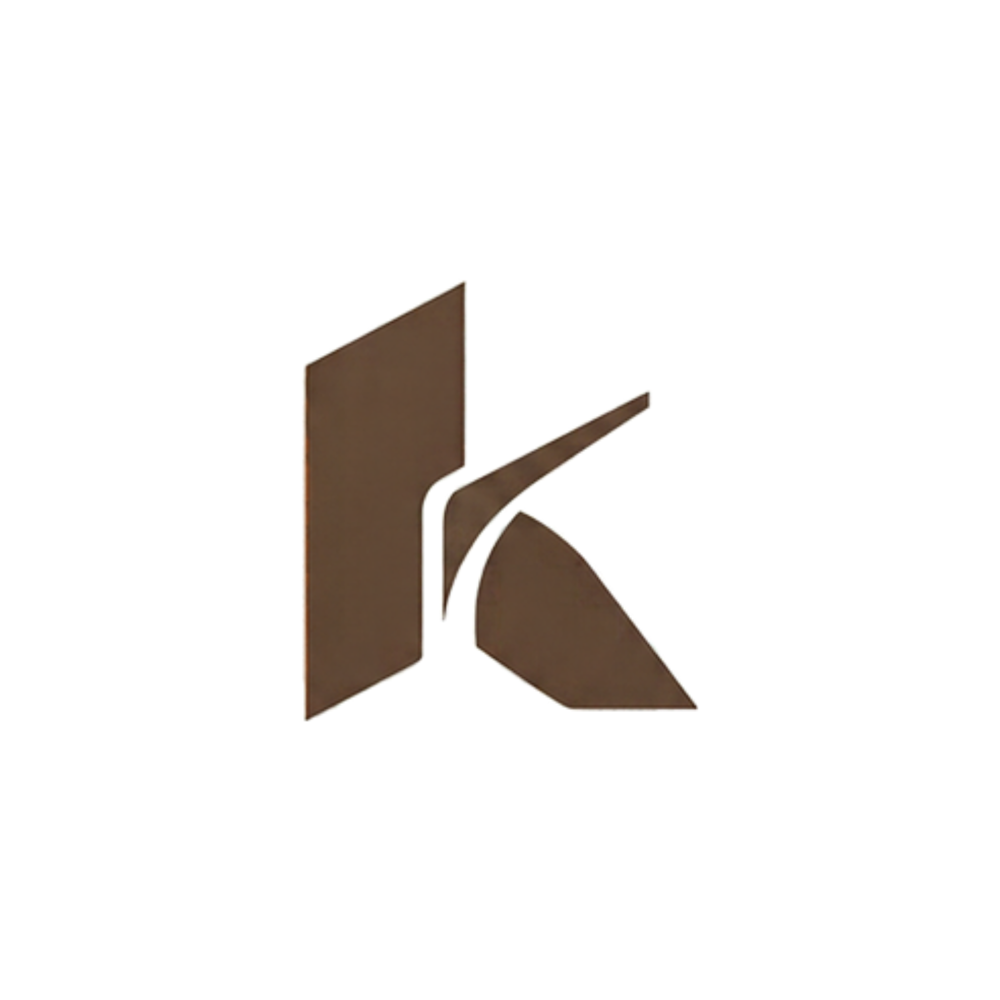
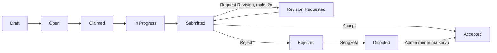

<p align="center"></p>


<h1 align="center">KARTA</h1>

<p align="center">
  <strong>Marketplace pekerjaan mikro berbasis kampus.</strong><br />
  Menghubungkan UMKM dengan mahasiswa dari kampus mitra, dengan harga tetap, hasil yang terukur, dan reputasi yang terverifikasi.
</p>

<p align="center">
  
  
  
  
  
  
  
</p>

---

## Tentang KARTA

KARTA (*Karya Mahasiswa untuk UMKM*) adalah platform **B2B2C** yang mempertemukan UMKM yang butuh bantuan tugas kecil dengan mahasiswa yang butuh penghasilan, pengalaman kerja nyata, dan portofolio.

Dikembangkan untuk lomba **IT Business Plan INFOVEST**, tema *Smart Ecosystems: Digital Solutions for a Sustainable Future*, subtema **Digital Economy & Sociopreneurship (SDG 8 & 10)**.

### Masalah yang diselesaikan

| Sisi | Masalah |
|---|---|
| **UMKM** | Butuh tenaga untuk tugas digital dan operasional, tetapi belum mampu merekrut karyawan tetap atau menyewa jasa profesional |
| **Mahasiswa** | Butuh penghasilan fleksibel dan pengalaman kerja nyata, sementara akses ke pekerjaan awal sangat terbatas |

### Cara kerja



1. **UMKM** berlangganan paket bulanan, lalu mempublikasikan pekerjaan mikro lengkap dengan deadline dan **checklist kriteria penerimaan**.
2. **Mahasiswa** dari kampus mitra (diverifikasi lewat kode referral kampus) mengambil pekerjaan dengan sistem *first-come-first-served*.
3. Hasil dikumpulkan lewat **tautan eksternal** (Google Drive, Figma, GitHub, dan sejenisnya).
4. UMKM menilai hasil per kriteria: **terima**, **minta revisi**, atau **tolak** dengan alasan.
5. Setelah diterima, imbalan tercatat di ledger (*Reserved → Payable → Paid*) dan mahasiswa mendapat poin serta rating.

## Pembeda

- **Jaringan tertutup berbasis kampus.** Akses mahasiswa hanya lewat kode referral kampus mitra.
- **Harga tetap per paket, tanpa tawar-menawar.** Imbalan mengikuti alokasi paket (60% mahasiswa, 40% platform), sehingga tidak ada perang harga.
- **Acceptance Checklist.** Penolakan dan permintaan revisi wajib menunjuk kriteria yang belum terpenuhi, sehingga penilaian lebih objektif dan sengketa lebih jarang.
- **KARTA Score dan portofolio terverifikasi.** Profil publik berisi pekerjaan yang benar-benar diterima UMKM.
- **Perlindungan kerja yang adil.** Revisi maksimal 2 kali, deadline minimum per kategori, review otomatis diterima bila UMKM tidak merespons, dan jendela sengketa.
- **Impact Dashboard.** Mengukur penghasilan tersalurkan, UMKM terbantu, dan sebaran wilayah untuk SDG 8 dan 10.

## Fitur MVP

| Peran | Fitur utama |
|---|---|
| **UMKM** | Langganan dan kuota, buat dan publish pekerjaan, checklist kriteria, review hasil, revisi, rating mahasiswa |
| **Mahasiswa** | Registrasi dengan kode kampus, cari dan ambil pekerjaan, kumpulkan hasil via tautan, saldo dan penarikan, poin, level, rating, portofolio publik |
| **Admin** | Kelola kampus, kode referral, paket, pekerjaan, transaksi, sengketa, laporan kegagalan, konfigurasi, dan Impact Dashboard |

Kategori pekerjaan: Data Entry, Content Writer, Graphic Designer, Video Editor, Social Media Officer, Junior Frontend Developer, UI/UX Designer.

Paket gratis menyediakan 3 pekerjaan per bulan yang berlabel **Volunteer Project** (tanpa imbalan uang, mahasiswa tetap mendapat poin).

## Tech Stack

| Lapisan | Teknologi |
|---|---|
| Framework | Next.js 16 (App Router), React 19, TypeScript |
| Database | PostgreSQL + Prisma ORM 7 |
| Autentikasi | Auth.js v5 (Google OAuth) |
| UI | Tailwind CSS, shadcn/ui, lucide-react |
| Form dan validasi | React Hook Form, Zod |
| Penyimpanan gambar | Vercel Blob |
| Pengujian | Vitest |
| Hosting | Vercel |

Arsitektur: **satu aplikasi Next.js (modular monolith)** dengan struktur berbasis fitur.

```
src/
├─ app/          # routing dan halaman (tipis)
├─ features/     # satu folder per domain: auth, jobs, subscription, wallet, ...
├─ components/   # ui (shadcn) dan layout
└─ lib/          # helper, konfigurasi database
prisma/          # schema, migrasi, seed
docs/            # PRD dan design system
```

## Memulai (Development)

**Prasyarat:** Node.js ≥ 20.19, pnpm, PostgreSQL (lokal atau Neon), akun Google Cloud untuk OAuth.

```bash
# 1. Clone dan install
git clone https://github.com/<username-github>/karta.git
cd karta
pnpm install

# 2. Salin env, lalu isi nilainya
cp .env.example .env.local        # PowerShell: Copy-Item .env.example .env.local

# 3. Siapkan database
pnpm db:migrate
pnpm db:seed

# 4. Jalankan
pnpm dev                          # http://localhost:3000
```

### Variabel lingkungan

| Variabel | Fungsi |
|---|---|
| `DATABASE_URL` | Koneksi database saat runtime (produksi: *pooled*) |
| `DIRECT_URL` | Koneksi langsung untuk migrasi |
| `AUTH_SECRET` | Rahasia sesi (`pnpm dlx auth secret`) |
| `AUTH_GOOGLE_ID`, `AUTH_GOOGLE_SECRET` | Kredensial Google OAuth |
| `ADMIN_EMAILS` | Daftar email admin, dipisah koma |
| `APP_URL` | URL aplikasi |
| `CRON_SECRET` | Rahasia untuk endpoint cron |
| `BLOB_READ_WRITE_TOKEN` | Token Vercel Blob (khusus server) |

Panduan setup lengkap, termasuk langkah migrasi manual untuk *partial unique index*, ada di Lampiran A pada [`docs/PRD.md`](docs/PRD.md).

### Skrip

| Perintah | Fungsi |
|---|---|
| `pnpm dev` | Jalankan server development |
| `pnpm build` | Build produksi |
| `pnpm typecheck` | Cek tipe TypeScript |
| `pnpm lint` | Jalankan ESLint |
| `pnpm test` | Jalankan Vitest |
| `pnpm db:migrate` | Jalankan migrasi Prisma |
| `pnpm db:seed` | Isi data awal |
| `pnpm db:studio` | Buka Prisma Studio |

## Dokumentasi

| Dokumen | Isi |
|---|---|
| [`docs/PRD.md`](docs/PRD.md) | Spesifikasi produk untuk developer: aturan bisnis, skema data, fitur, rencana build |
| [`docs/DESIGN_SYSTEM.md`](docs/DESIGN_SYSTEM.md) | Panduan visual dan komponen UI |

## Alur Git

| Branch | Fungsi |
|---|---|
| `main` | Kode stabil, mengarah ke deploy produksi |
| `dev` | Tempat menggabungkan hasil tiap fase |
| `fase-N-nama` | Branch kerja per fase, dibuat dari `dev` |

Perubahan masuk ke `dev` lewat merge dari branch fase, lalu naik ke `main` lewat Pull Request.

## Status dan Roadmap

## Tim

| Peran | Fokus |
|---|---|
| Business & Product | Strategi bisnis, riset pasar, perencanaan produk |
| System Architect & Full-Stack Developer | Arsitektur sistem, UI/UX, frontend, backend, database, deployment |
| Finance | Perencanaan keuangan, kelayakan bisnis, penganggaran |

## Lisensi

Belum ditentukan. Selama belum ada lisensi, seluruh hak cipta dipegang oleh tim pengembang.
